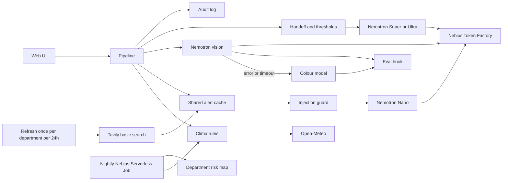

# AgroClima Agent

**Live demo:** https://agroclima-demo.jaime-8a8.workers.dev (stable Cloudflare Worker proxy in front of the Nebius AI endpoint).

Public demo: https://port8080-mvk3d4wrrkt7g6k.tunnel.applications.us-north1.nebius.cloud

AgroClima Agent helps a small coffee farmer in El Salvador see the week’s coffee-rust risk, current official alerts, a leaf check, and a short plan. Risk levels and technician handoff are fixed rules. NVIDIA open models on Nebius Token Factory only summarize, read the leaf, and word the plan that the rules already decided.

## How to test

The demo is hosted on a Nebius AI endpoint in us-north1. Model calls go to Nebius Token Factory and use NVIDIA Nemotron. The page is Spanish by default, with an ES/EN toggle.

Open the UI and choose Santa Ana. Ask a coffee question such as “¿Cómo está el riesgo de roya esta semana?”

```bash
curl -sS https://port8080-mvk3d4wrrkt7g6k.tunnel.applications.us-north1.nebius.cloud/api/health
```

```bash
curl -sS -X POST https://port8080-mvk3d4wrrkt7g6k.tunnel.applications.us-north1.nebius.cloud/api/run \
  -F "department=Santa Ana" \
  -F "question=¿Cómo está el riesgo de roya esta semana?" \
  -F "language=es"
```

`/api/run` allows about 10 requests per 10 minutes from one address, and `AGROCLIMA_DAILY_RUN_CAP` model runs per El Salvador day (default 300). `/api/health` and the page stay available after either limit.

This is the Nebius Global AI Hackathon entry for the Best Apps and Agents track, with the Tavily bonus. Submission deadline: Friday 30 October 2026, 11:00 America/El_Salvador. It is a new version of [jaime-sql/agroclima](https://github.com/jaime-sql/agroclima). What changed is written in [docs/changes-from-agroclima.md](docs/changes-from-agroclima.md).

## NVIDIA models on Nebius

Live inference uses the Nebius Token Factory OpenAI-compatible API (`NEBIUS_BASE_URL`, default `https://api.tokenfactory.nebius.com/v1`) and these NVIDIA open models:

| Step | Model env | Default id |
| --- | --- | --- |
| Fast summary and the farmer’s question | `NEBIUS_MODEL_NANO` | `nvidia/NVIDIA-Nemotron-3-Nano-30B-A3B` |
| Action-plan wording | `NEBIUS_MODEL_PLAN` | `nvidia/nemotron-3-super-120b-a12b` (set `nvidia/Nemotron-3-Ultra-550b-a55b` for Ultra) |
| Leaf photo | `NEBIUS_MODEL_VISION` | `nvidia/Nemotron-3.5-Super-VL` |

The leaf call loads `src/agroclima_agent/data/frozen_config.json` at runtime and sends that file’s prompt v1 unchanged, with temperature 0, reasoning off (`enable_thinking` false), and `max_tokens` 200.

The nightly department map does not call a model. It only reads Open-Meteo and the rules in [docs/rust-risk-rules.md](docs/rust-risk-rules.md).

## Run

```bash
./run
```

Then open http://127.0.0.1:8000. The first run creates `.venv` and installs the package. With `NEBIUS_API_KEY` unset, the page shows a mock-mode banner and the model steps are labelled samples. An empty `TAVILY_API_KEY` does not raise that banner: alerts stay «sin actualizar». CI uses empty keys and does not need secrets.

```bash
pip install -e ".[dev]"
pytest
agroclima-eval
agroclima-nightly --fixture --output var/risk-map.json
```

## Setup

Python 3.12 or newer.

```bash
python3 -m venv .venv
. .venv/bin/activate
pip install -e ".[dev]"
cp .env.example .env
# put keys only in .env, never in git
./run
```

The web form asks for a department, an optional leaf photo, and an optional question. It walks **Clima → Alertas oficiales → Diagnóstico → Plan** and lists citations under the alert step. Chrome is English. Sentences meant for the farmer are Spanish.

## Environment

| Variable | Required | Purpose |
| --- | --- | --- |
| `NEBIUS_API_KEY` | Live models | Token Factory key. Empty → mock model steps |
| `NEBIUS_BASE_URL` | No | Default `https://api.tokenfactory.nebius.com/v1` |
| `TAVILY_API_KEY` | Live alert refresh | Tavily key. Empty → alerts stay «sin actualizar» and the rest of the app stays live. Page loads never call Tavily |
| `TECHNICIAN_WHATSAPP` | No | Digits only, country code included. Empty → «Consultar a un técnico» stays on this page |
| `TAVILY_DAILY_CAP` | No | Default `40`. After this many basic searches in a local day, refresh stops |
| `TAVILY_TOTAL_CAP` | No | Default `300` (dev/testing budget inside the 1,500 credit monthly account) |
| `NEBIUS_MODEL_NANO` | No | Nano id above |
| `NEBIUS_MODEL_PLAN` | No | Super id above, or Ultra |
| `NEBIUS_MODEL_VISION` | No | Vision id above |
| `AGROCLIMA_AUDIT_LOG` | No | JSONL audit path, default `var/audit.jsonl`. On Vercel this default is `/tmp/audit.jsonl` |
| `AGROCLIMA_HOST` / `AGROCLIMA_PORT` | No | Default `127.0.0.1:8000`. Cloud Run injects `PORT`, and that value wins. An unset host listens on `0.0.0.0` when `PORT` is set |
| `OPEN_METEO_BASE_URL` | No | Forecast endpoint |
| `AGROCLIMA_DAILY_RUN_CAP` | No | Default `300`. After this many `/api/run` model calls on the El Salvador day, the demo stops calling the model |

Only `.env.example` is committed. `.env` is gitignored. The audit log stores a SHA-256 of the redacted input, the model id, latency, and token counts when the API returns them. It does not store the keys, the photo, or the raw question.

## Architecture



Clima scores each coffee municipality in the chosen department and keeps the worst level. Alertas reads a shared cache of official rust notices (CENTA, MAG, ISC, OIRSA, IICA, FAO) and treats that text as data. Diagnóstico sends the photo to `nvidia/Nemotron-3.5-Super-VL`. If that call errors or times out, the colour model answers and the audit log records which path was used. The colour model does not authorize a product. The page hides per-leaf confidence. Plan fills class name, dose note, spray window, and handoff from the rules, then asks Super or Ultra to say that decision in Spanish. A numeric dose in the model text is discarded.

## Tavily budget

The hackathon account has 1,500 credits per month. This app keeps a smaller dev/testing ceiling so a loop cannot spend the month in one day.

| Control | Value |
| --- | --- |
| Call type | `search_depth=basic` only, 1 credit. `max_results` is 5 |
| Not used | advanced search, extract, crawl, map |
| Who may call | `agroclima-alerts`, at most once per department every 24 hours |
| Who never calls | a page load, `/api/run`, and the nightly risk job |
| `TAVILY_DAILY_CAP` | 40 searches on the El Salvador calendar day |
| `TAVILY_TOTAL_CAP` | 300 searches, persisted across days |

A repeat visit reads `var/tavily-cache.json` and costs 0 credits. When a cap is already reached, refresh keeps the last saved alerts and the page labels them **sin actualizar**. It does not call Tavily. `GET /api/tavily-usage` reads the audit log and returns `{ "count", "credits" }` for those basic searches. Every real call is one audit line with `step` `tavily-search` and `credits` 1.

```bash
agroclima-alerts
```

## Nightly job

`deploy/nebius-job.json` is a Nebius Serverless AI job body for `POST /ai/v1/jobs` ([jobs](https://docs.nebius.com/serverless/jobs/manage)). The container command is `python -m agroclima_agent.jobs.nightly`. Fill the project id, subnet, image, and a **CPU** platform and preset in your project (the weather job does not need a GPU). Build with:

```bash
docker build -t agroclima-agent .
```

The public create example has no cron field. Schedule the job in the Serverless AI console every day at 06:00 America/El_Salvador (12:00 UTC). The entrypoint is safe to run again. `agroclima-nightly --fixture` writes a map without calling Open-Meteo, which is what CI runs through pytest. That job does not call Tavily. Alert refresh is `agroclima-alerts`, on its own schedule.

The web UI, if you want it in the same image:

```bash
docker run --rm -p 8000:8000 agroclima-agent python -m agroclima_agent
```

## Vercel

`api/index.py` exports the FastAPI app for Vercel’s Python runtime. The same process serves the page, `/api/health`, and `/api/run`. When `VERCEL=1`, the `var/` audit and Tavily files are written under `/tmp`. `NEBIUS_API_KEY` and `TAVILY_API_KEY` are read from the environment. Leave `TECHNICIAN_WHATSAPP` empty.

In the Vercel project, use framework preset **FastAPI**, root directory **.** (the repository root), and no build command, install-command override, or output directory. `pyproject.toml` sets the entrypoint to `api.index:app`.

## Tests

GitHub Actions (`.github/workflows/ci.yml`) installs the package and runs `pytest` with empty keys. The suite covers the rust rules, handoff, PII redaction, the Tavily injection guard, mock mode, the Token Factory request shape, the histogram eval, and the department map.

## License

MIT. See [LICENSE](LICENSE). Copyright (c) 2026 Jaime Garcia.

Weather thresholds are an engineering estimate on top of the papers cited in the rules note. They have not been validated by the ISC, CENTA, or the MAG. The app is an orientation, not a diagnosis and not a pesticide label.
